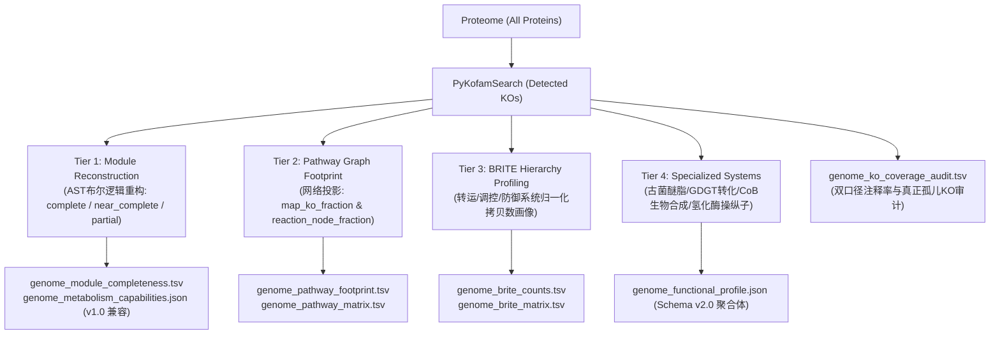

# 四层功能证据体系重构引擎 (`pathway_reconstruction`)

## 1. 概述与核心科学语义

本模块为 **生物价值系统 (BVS, Bio-energetic & Metabolic Virtual System)** 与大规模 MAG 注释提供核心的生物学功能解释层。
系统以通用 KOfam 一级证据 `protein_KO_all_strict.tsv.gz` 作为输入，彻底收紧科学语义，建立**四层功能证据体系 (Four-Tier Functional Evidence Architecture)**：



### 四层核心职责划分
- **Tier 1 (Module Reconstruction)**：**可判定的功能单元重构**。基于 KEGG 明确定义的 KO 逻辑表达式进行功能单元重构；严格区分 `definition_satisfied == true`（唯一判定为 `complete`）与连续得分（用于 `near_complete` 与 `partial`）。
- **Tier 2 (Pathway Map Footprint)**：**宏观网络投影与反应节点覆盖**。严禁使用 `completeness`，严格采用 `map_ko_fraction` 与 `reaction_node_fraction`（非代谢通路严格输出 `NA`）。基于三元交集 $(P \cap Q \cap R)$ 消除跨通路反应污染。
- **Tier 3 (BRITE Molecular-System Profiling)**：**全层级功能分类与分子机器画像**。基于可变深度多标签体系，输出绝对计数与基因组大小标准化拷贝数 (`copies_per_1000_proteins`)。
- **Tier 4 (Specialized Systems & Classifiers)**：**特殊复杂系统判型**。遵循官方知识优先原则；古菌醚脂拆分为核心双醚与四醚 (Tes/GDGT) 分支；氢化酶引入多维证据与可配置物理邻距；移除重复的 M_ARCH_02，改用 `ED_pathway_family_profile` 组合解释。

---

## 2. 严格履行的 10 大科学质量控制门禁 (The 10 Gates)

| 门禁 | 门禁名称 | 核心机制 |
| :---: | :--- | :--- |
| **G1** | **Snapshot Gate** | 知识库输出 `kegg_snapshot_manifest.json` 与全文件 SHA256，严禁硬编码任何统计比例。 |
| **G2** | **Pathway Semantic Gate** | Tier 2 严禁出现 `completeness` / `activity`，严格使用 `map_ko_fraction` 与 `reaction_node_fraction`。 |
| **G3** | **Taxonomy & Scope Gate** | 全部 587 个 map 标注 `is_prokaryote_relevant` 与 `microbial_relevance`，默认筛选原核子集。 |
| **G4** | **Canonical-ID Gate** | 统一规范化为 5 位数字 ID，严格去除 `map` 与 `ko` 重复，消除双重计数。 |
| **G5** | **BRITE Multi-Membership Gate** | 允许同一 KO 多归属，严禁跨体系简单加和；输出基因组大小标准化指标。 |
| **G6** | **Proteome Coverage Gate** | 严格区分 `protein_ko_annotation_rate` 与 `ko_hierarchy_assignment_rate`，从 09190 识别真正的 `orphan_kos`。 |
| **G7** | **Custom Evidence Gate** | 自定义模块必须声明 `evidence_type`，复杂复合体不得退化为纯 KO 布尔相加。 |
| **G8** | **Official-First Gate** | 已有官方 Module 严禁重复实现，自定义必须声明 `extends`/`complements`/`not_in_kegg_module`。 |
| **G9** | **Identifier Validation Gate** | 实时核对 YAML 中 K/M/R/EC 编号与官方定义的一致性，阻断错号污染。 |
| **G10**| **Applicability / NA Gate** | 不适用指标严格输出 `NA` 及 `applicable_reason`，非代谢通路反应指标严禁为 0。 |

---

## 3. 产物目录结构说明

```text
results/pathway_reconstruction/{sample}/
├── modules/                                      # [Tier 1] 模块重构
│   ├── genome_module_completeness.tsv            # 包含 definition_satisfied 与 status (complete/near_complete/partial)
│   ├── genome_module_presence.tsv                # 定性有无状态
│   ├── genome_module_matrix.tsv                  # 模块完整度稠密宽表
│   └── module_evidence.tsv                       # 坐标级全链路证据溯源表
├── pathways/                                     # [Tier 2] 通路网络投影
│   ├── genome_pathway_footprint.tsv              # map_ko_fraction, reaction_node_fraction 及 NA 标记长表
│   └── genome_pathway_matrix.tsv                 # 原核相关通路指纹稠密宽表
├── brite/                                        # [Tier 3] 分子机器与系统画像
│   ├── genome_brite_counts.tsv                   # 转运体/双组分/防御系统归一化拷贝数表 (copies_per_1000_proteins)
│   └── genome_brite_matrix.tsv                   # 核心系统丰度宽表
├── audit/                                        # [Global Audit] 覆盖度审计
│   └── genome_ko_coverage_audit.tsv              # 蛋白注释率、层级追踪率与真正孤儿 KO 审计表
└── capabilities/                                 # [Tier 4 & Unified Profiles]
    ├── genome_metabolism_capabilities.json       # [Schema v1.0] 核心能量代谢画像 (100% 格式路径零破坏)
    └── genome_functional_profile.json            # [Schema v2.0] 四层体系全域画像 (含 ED 家族与古菌特殊系统)
```
